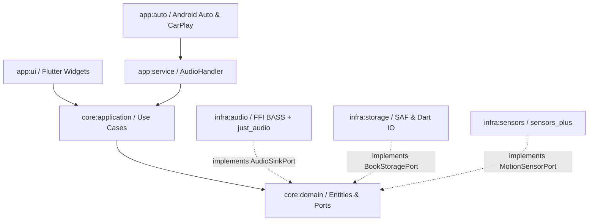
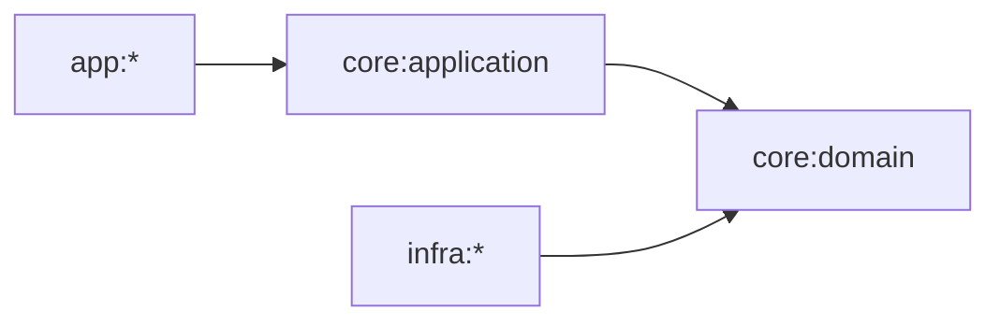
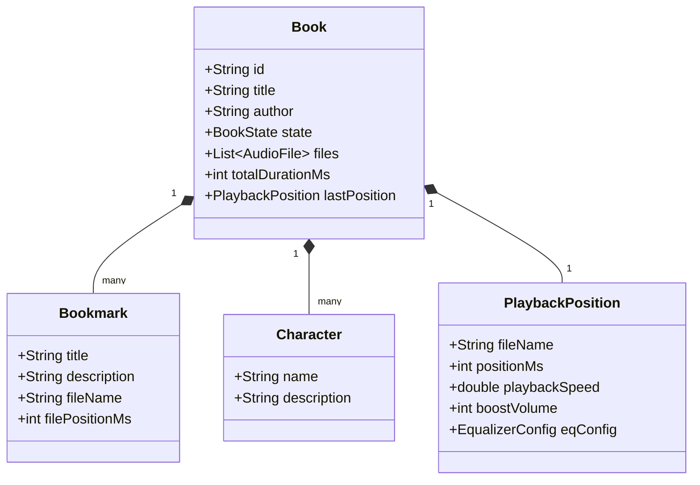

# Architecture Spine — FolderPlay

## Design Paradigm

The application is structured as a **Ports and Adapters (Hexagonal Architecture)** system in **Flutter & Dart**, combined with a unidirectional reactive state machine. The business rules of audiobook listening—continuous multi-file position tracking, pause-proportional auto-rewind calculation, sleep countdowns, and bookmark management—are decoupled from Flutter UI widgets, platform channels, audio hardware drivers, and filesystem APIs.

- **Domain Core (`lib/core/domain/`):** Pure Dart business logic with zero `flutter/*` or platform dependencies. Owns `Book` aggregates, `Bookmark` entities, `AutoRewindAlgorithm`, `SleepTimerPolicy`, and abstract port interfaces (`AudioSinkPort`, `BookStoragePort`, `MotionSensorPort`).
- **Application Layer (`lib/core/application/`):** Dart use cases orchestrating domain entities (`PlayBookUseCase`, `SeekPositionUseCase`, `HandleMotionResetUseCase`, `ExportSidecarUseCase`).
- **Secondary Adapters / Infrastructure (`lib/infra/`):** Concrete implementations of domain ports:
  - Audio Sink Adapters (`infra/audio/`): Low-level DSP engine using Dart FFI (`dart:ffi`) to bind Un4seen BASS (`libbass.so` / `.dylib`) + RNNoise de-noising, with cross-platform fallback to `just_audio`.
  - Storage Adapters (`infra/storage/`): Dart `dart:io` atomic file operations and platform channels for Android Storage Access Framework (SAF) URI tree persistence and iOS Documents directory.
  - Sensor Adapters (`infra/sensors/`): Device accelerometer motion detection stream via `sensors_plus`.
- **Primary Adapters / UI & Entry Points (`lib/app/`):**
  - Background Service (`app/service/`): Background audio execution via `audio_service` (`BaseAudioHandler`), maintaining the persistent notification, lock-screen controls, and Android Auto / CarPlay integration.
  - UI Presentation (`app/ui/`): Material 3 Flutter widgets with reactive state management (`flutter_bloc`), observing unidirectional streams.



---

## Invariants & Rules



### AD-1 — Domain Framework Isolation

- **Binds:** `lib/core/domain/`, all domain entities (`Book`, `Bookmark`, `Character`, `AutoRewindAlgorithm`, `EqualizerConfig`)
- **Prevents:** Business logic coupling to Flutter UI changes, widget trees, platform channels, or OS-specific mocks.
- **Rule:** Code inside `lib/core/domain/` MUST be pure Dart and MUST NOT import any package under `package:flutter/*`, `dart:ui`, or platform-specific libraries. All platform capabilities (storage, audio hardware, sensors) MUST be declared as abstract Dart classes (Ports) in the domain layer.

### AD-2 — Zero-Centralized Relational Database Invariant

- **Binds:** `infra/storage/`, FR-12, FR-16
- **Prevents:** Metadata desynchronization, loss of progress on folder renames, or reliance on non-portable local SQLite/Room/Isar stores that trap user metadata.
- **Rule:** The persistent source of truth for book metadata, playback timestamps, bookmarks, and character rosters MUST reside strictly within sidecar files in the individual book's folder (`position.sabp.dat`, `bookmarks.sabp.xml`, `characters.sabp.xml`, `info.txt`). Centralized cache indices are strictly ephemeral in-memory maps reconstructible on-demand.

### AD-3 — Dual-Engine AudioSink Port Abstraction

- **Binds:** `infra/audio/`, FR-1, FR-2, FR-3, FR-4, FR-5
- **Prevents:** Direct audio API calls leaking into Flutter widgets or background services, allowing native DSP plugins without breaking standard audio paths.
- **Rule:** Playback controllers MUST interact with audio hardware solely through the `AudioSinkPort` Dart interface. The implementation MUST provide two swappable strategies: `BassFfiAudioSink` (primary native engine via Dart FFI incorporating BASS FX tempo and RNNoise de-noising) and `JustAudioSink` (cross-platform `just_audio` fallback). Engine switching MUST preserve position and volume seamlessly.

### AD-4 — Atomic Two-Phase Sidecar Commit

- **Binds:** `infra/storage/`, FR-16
- **Prevents:** Truncated or corrupt sidecar files resulting from sudden battery depletion, OS low-memory process kills, or unscheduled storage unmounts.
- **Rule:** All writes to sidecar files (`position.sabp.dat`, `bookmarks.sabp.xml`, `characters.sabp.xml`) MUST be written to an adjacent temporary file (`<target>.tmp`), flushed with `flush: true` via `dart:io`, and then atomically renamed onto the destination filename.

### AD-5 — Single Source of Playback Truth in AudioHandler

- **Binds:** `app/service/`, `app/ui/`, FR-6, FR-7, FR-22, FR-25, FR-26
- **Prevents:** Divergent position calculations between Flutter UI timers, lock-screen notifications, and automotive head units.
- **Rule:** The playback state machine, elapsed time calculations, and pause auto-rewind logic MUST be owned exclusively by the singleton `AudioBookAudioHandler` (extending `audio_service`'s `BaseAudioHandler`). Flutter UI screens, home widgets, and platform broadcast receivers are strictly read-only stream observers emitting player command events.

### AD-6 — Service-Scoped Sensor Lifecycles

- **Binds:** `infra/sensors/`, FR-8, FR-9, FR-10
- **Prevents:** Sleep timer accelerometer listeners running when playback is idle, draining device battery or being killed by OS background throttling.
- **Rule:** Motion tracking listeners (`accelerometerEventStream` via `sensors_plus`) MUST be subscribed to strictly within the active lifecycle of the `AudioBookAudioHandler` during active sleep countdowns. When audio stops or sleep timer expires, the stream subscription MUST be immediately cancelled.

### AD-7 — Decoupled Feature Tier Policy Gate

- **Binds:** `core/domain/policy/`, FR-29
- **Prevents:** Commercial licensing checks and in-app purchase store code from tangling into core audio playback logic.
- **Rule:** Access to Full Version capabilities (RNNoise denoise, pitch adjustment, Opus transcoding, custom EQ) MUST be evaluated through a declarative `FeaturePolicyGate` interface. The audio engine and Flutter UI MUST query feature entitlement via capability tokens, completely decoupled from Google Play Billing or Apple StoreKit implementations.

---

## Consistency Conventions

| Concern | Convention |
| :--- | :--- |
| Naming: Files | snake_case (`book.dart`, `bookmark.dart`, `play_book_use_case.dart`) |
| Naming: Domain Entities | Singular PascalCase (`Book`, `Bookmark`, `Character`, `PlaybackPosition`) |
| Naming: Ports & Adapters | Ports suffixed with `Port` (`AudioSinkPort`, `BookStoragePort`), Adapters named by technology (`BassFfiAudioSink`, `SafDocumentFileStorageAdapter`) |
| Naming: Use Cases | Verb + Noun + `UseCase` (`SeekPositionUseCase`, `TriggerSleepResetUseCase`) |
| Data: Timestamps | Milliseconds as 64-bit integer (`int`) relative to track start, dates as Unix Epoch milliseconds (`int`) |
| Data: Audio Formats | Exhaustive sealed class hierarchy `AudioFormat` (`Mp3`, `Opus`, `M4b`, `Flac`, `Aac`) |
| State: Unidirectional Flow | Use Cases expose immutable Dart `Stream<T>` or `ValueStream<T>` |
| Error Handling | Sealed class `AudioPlayerError` (`CorruptFile`, `CodecNotFound`, `StoragePermissionRevoked`, `SinkInitializationFailed`) |
| Concurrency & Threading | Heavy DSP / decoding in native C/JNI threads via FFI, File IO in Dart asynchronous microtasks/isolates, UI on Flutter main isolate |

---

## Stack

| Name | Version |
| :--- | :--- |
| Flutter SDK | 3.22.2 |
| Dart SDK | 3.4.3 |
| audio_service | 0.18.17 |
| just_audio | 0.9.38 |
| just_audio_background | 0.0.1-beta.11 |
| sensors_plus | 5.0.2 |
| flutter_bloc | 8.1.6 |
| xml | 6.5.0 |
| path_provider | 2.1.3 |
| ffi | 2.1.2 |
| in_app_purchase | 3.2.0 |
| Un4seen BASS Core (`libbass.so` / `.dylib`) | 2.4.17 |
| Un4seen BASS_FX (`libbass_fx.so` / `.dylib`) | 2.4.12 |
| Xiph RNNoise (`librnnoise.so` / `.dylib`) | 0.2 |

---

## Structural Seed



### Module and Directory Structure

```text
lib/
  core/
    domain/             # Pure Dart domain entities, value objects, ports, and auto-rewind logic
      model/            # book.dart, bookmark.dart, character.dart, audio_file.dart
      port/             # audio_sink_port.dart, book_storage_port.dart, motion_sensor_port.dart
      algorithm/        # auto_rewind_calculator.dart, natural_sort_comparator.dart
    application/        # Use cases and domain flow orchestration
      usecase/          # play_book_use_case.dart, seek_position_use_case.dart, sleep_timer_use_case.dart
  infra/
    audio/              # AudioSinkPort implementations
      bass_ffi/         # bass_ffi_audio_sink.dart (bindings to libbass, libbass_fx, librnnoise)
      just_audio/       # just_audio_sink.dart (cross-platform fallback audio sink)
    storage/            # BookStoragePort implementations
      saf/              # saf_storage_adapter.dart (Android Storage Access Framework bridge)
      serializer/       # dat_serializer.dart, xml_bookmark_serializer.dart
    sensors/            # motion_sensor_adapter.dart (sensors_plus accelerometer stream)
  app/
    service/            # audio_book_audio_handler.dart (audio_service BaseAudioHandler implementation)
    ui/                 # Flutter widgets, screens, blocs, themes
      player/           # player_screen.dart, bedside_screen.dart, equalizer_sheet.dart
      library/          # library_screen.dart, book_queue_screen.dart, folder_settings_screen.dart
      bookmarks/        # bookmarks_screen.dart, character_list_screen.dart
      common/           # widgets, theme, formatters
```

---

## Capability → Architecture Map

| Capability / Area | Lives in | Governed by |
| :--- | :--- | :--- |
| FR-1 Speed & FR-2 Pitch | `lib/infra/audio/bass_ffi/` | AD-3, AudioSinkPort |
| FR-3 RNNoise Speech Filter | `lib/infra/audio/bass_ffi/` | AD-3, AD-7 |
| FR-4 Volume Boost & FR-5 EQ | `lib/infra/audio/` | AD-3, AudioSinkPort |
| FR-6 Proportional Auto-Rewind | `lib/core/domain/algorithm/` | AD-1, AD-5 |
| FR-8 Sleep Timer & FR-9 Fadeout | `lib/core/domain/model/` | AD-1, AD-5 |
| FR-10 Shake-to-Reset Motion | `lib/infra/sensors/` | AD-6 |
| FR-12 SAF Root Folders | `lib/infra/storage/saf/` | AD-2 |
| FR-13 Book States & FR-14 Multi-File | `lib/core/domain/model/` | AD-1 |
| FR-16 `.sabp` Sidecar Persistence | `lib/infra/storage/serializer/` | AD-2, AD-4 |
| FR-17 Bookmarks & FR-18 Characters | `lib/core/domain/model/` & `lib/infra/storage/` | AD-1, AD-2, AD-4 |
| FR-21 MP3-to-Opus Background Transcoder | `lib/infra/audio/transcoder/` | AD-7 |
| FR-22 Android Auto & CarPlay | `lib/app/service/` | AD-5, audio_service |
| FR-25 Home Screen Widgets | Native Platform Channel & `home_widget` | AD-5 |
| FR-26 Tasker Broadcast Actions | Android Native Broadcast Channel | AD-5 |
| FR-27 Gemini AI Prompts | `lib/app/ui/enrichment/` | AD-1 |
| FR-29 Feature Tier Gating | `lib/core/domain/policy/` | AD-7 |

---

## Deferred

1. **Pure Dart Audio Codec Decoding:** Rely on native C/C++ audio libraries (BASS / just_audio engines) rather than writing custom Dart audio decoders for MP3/Opus/M4B.
2. **Web / WebAssembly Target:** Audio processing via Web Audio API is deferred until mobile (Android/iOS) and desktop builds stabilize.
3. **Cloud WebDAV / Nextcloud Direct Sync:** Intentionally pushed out of scope to preserve 100% offline-first sidecar portability.
